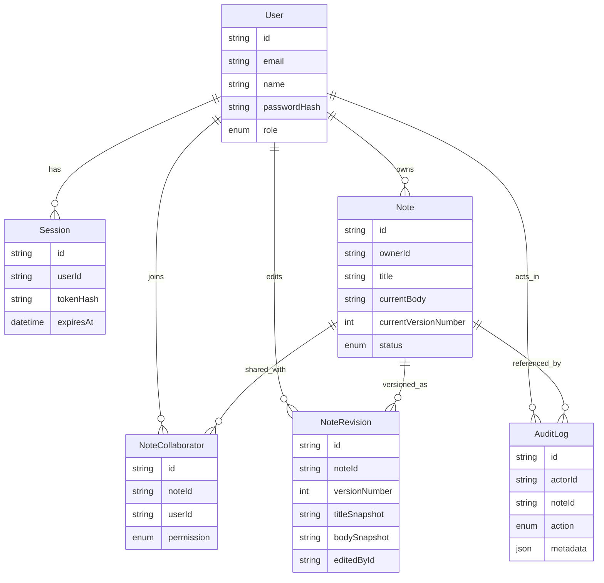

# Domain Model

The diagram shows the main columns only. The sections below list every field, constraint, and delete rule from `prisma/schema.prisma`. The datasource is PostgreSQL (`prisma/schema.prisma:15-18`). All ids are `cuid()` strings.

## User
Model: `prisma/schema.prisma` — `model User`
Primary service: `src/services/auth-service.ts` — `login()`

| Field | Type | Constraint / default | Line |
| --- | --- | --- | --- |
| `id` | String | `@id @default(cuid())` | 48 |
| `email` | String | `@unique` | 49 |
| `name` | String | | 50 |
| `passwordHash` | String | bcrypt, cost 12 (`src/lib/auth/password.ts:9`) | 51 |
| `role` | `SystemRole` | `@default(MEMBER)`; values `APP_ADMIN`, `MEMBER` (`:20-23`) | 52 |
| `createdAt` / `updatedAt` | DateTime | `now()` / `@updatedAt` | 53-54 |

Users are only created by `prisma/seed.ts:31-56`. No route creates, updates, or deletes a user. `email` is unique but not case-insensitive in the database. The app keeps it consistent by lowercasing at the API boundary (`src/lib/validation/auth-schemas.ts:10`, `src/lib/validation/note-schemas.ts:27`), so a row inserted manually with capitals could never log in or be shared with. `findSessionUserById()` exists in `src/repositories/user-repository.ts:16-26` but has no caller.

## Session
Model: `prisma/schema.prisma` — `model Session`
Primary service: `src/services/auth-service.ts` — `login()` and `src/lib/auth/session.ts` — `resolveRequestSession()`

| Field | Type | Constraint / default | Line |
| --- | --- | --- | --- |
| `userId` | String | FK to `User`, `onDelete: Cascade` | 64, 69 |
| `tokenHash` | String | `@unique`; `sha256(token:SESSION_SECRET)` hex | 65 |
| `expiresAt` | DateTime | login time + 14 days | 66 |
| `createdAt` | DateTime | `now()` | 67 |
| `lastSeenAt` | DateTime | `now()`; bumped on each API request (`src/lib/auth/session.ts:57`) | 68 |

Indexes: `@@index([userId])`, `@@index([expiresAt])` (`:71-72`). Nothing queries by `expiresAt`. Expired rows are filtered out at read time (`session.ts:53`) but never deleted.

## Note
Model: `prisma/schema.prisma` — `model Note`
Primary service: `src/services/note-service.ts` — `createNote()`, `getNoteDetail()`, `updateNote()`, and `updateStatus()`

| Field | Type | Constraint / default | Line |
| --- | --- | --- | --- |
| `title` | String | 3-120 chars after trim (`note-schemas.ts:15`, `:20`) | 77 |
| `currentBody` | String | 1-20,000 chars after trim (`note-schemas.ts:16`, `:21`) | 78 |
| `currentVersionNumber` | Int | `@default(1)`; incremented by exactly 1 per save | 79 |
| `status` | `NoteStatus` | `@default(ACTIVE)`; `ACTIVE` or `ARCHIVED` | 80 |
| `ownerId` | String | FK to `User`, `onDelete: Cascade` | 81, 85 |
| `updatedAt` | DateTime | `@updatedAt`, also set explicitly on save and status change | 83 |
| `lastEditedAt` | DateTime | set on content saves only (`note-repository.ts:190`) | 84 |

Indexes: `ownerId`, `status`, `updatedAt` (`:90-92`). The note list sorts by `status asc, updatedAt desc` (`src/repositories/note-repository.ts:81`), so ACTIVE notes come before ARCHIVED ones (enum order), and the most recently touched note comes first within each group.

## NoteCollaborator
Model: `prisma/schema.prisma` — `model NoteCollaborator`
Primary service: `src/services/note-service.ts` — `upsertCollaborator()`

| Field | Type | Constraint / default | Line |
| --- | --- | --- | --- |
| `noteId` | String | FK, `onDelete: Cascade` | 97, 102 |
| `userId` | String | FK, `onDelete: Cascade` | 98, 103 |
| `permission` | `NotePermission` | `OWNER`, `EDITOR`, `VIEWER` (`:25-29`) | 99 |

Constraints: `@@unique([noteId, userId])` (`:105`) makes `upsertCollaborator()` race-safe, because two concurrent shares to the same user resolve to one row. `@@index([userId, permission])` (`:106`) supports the `collaborators: { some: { userId } }` filter.

This table is the access-control list. A member can see a note **only** if a row here names them (`src/repositories/note-repository.ts:27-34`). `Note.ownerId` alone grants nothing to a member. That is why `createNote()` always inserts an `OWNER` row for the creator (`note-repository.ts:144-149`), and why the seed inserts one for the seeded owner (`prisma/seed.ts:64-69`).

## NoteRevision
Model: `prisma/schema.prisma` — `model NoteRevision`
Primary service: `src/services/note-service.ts` — `updateNote()` and `listRevisions()`

| Field | Type | Constraint / default | Line |
| --- | --- | --- | --- |
| `noteId` | String | FK, `onDelete: Cascade` | 111, 118 |
| `versionNumber` | Int | `@@unique([noteId, versionNumber])` | 112, 121 |
| `titleSnapshot` / `bodySnapshot` | String | full copies of the saved title and body | 113-114 |
| `changeSummary` | String? | up to 160 chars (`note-schemas.ts:23`); `"Initial version"` for v1 | 115 |
| `editedById` | String | FK to `User`, `onDelete: Restrict` | 116, 119 |

Revisions are append-only in practice: no code path updates or deletes a `NoteRevision` (the only writes are `create` at `note-repository.ts:151-157` and `:198-207`). The unique constraint is a second line of defense behind the conditional update. Even if two saves somehow both passed the version check, the second revision insert for the same `versionNumber` would fail and roll back its transaction.

Status changes do not create revisions. Archiving and restoring leave `currentVersionNumber` alone.

## AuditLog
Model: `prisma/schema.prisma` — `model AuditLog`
Primary service: `src/services/auth-service.ts`, `src/services/note-service.ts`, and `src/services/audit-log-service.ts`

| Field | Type | Constraint / default | Line |
| --- | --- | --- | --- |
| `actorId` | String? | FK to `User`, `onDelete: Cascade` | 127, 132 |
| `noteId` | String? | FK to `Note`, `onDelete: Cascade` | 128, 133 |
| `action` | `AuditAction` | 8 values (`:36-45`) | 129 |
| `metadata` | Json? | free-form, shape depends on action | 130 |

Indexes on `(actorId, createdAt)`, `(noteId, createdAt)`, `(action, createdAt)` (`:135-137`). The only reader, `listRecent()`, orders by `createdAt desc` with `take: 40` and no filter (`src/repositories/audit-log-repository.ts:42-62`), so none of the three composite indexes is used by current code.

### Who writes each audit action

| Action | Written at | `actorId` | `noteId` | `metadata` | In a transaction with the change? |
| --- | --- | --- | --- | --- | --- |
| `LOGIN_FAILED` | `src/services/auth-service.ts:33-37` | user id if the email exists, else `null` | null | `{ email }` (as typed, lowercased) | n/a |
| `LOGIN_SUCCEEDED` | `auth-service.ts:51-55` | user id | null | `{ email }` | no: written after the session insert, separately |
| `LOGOUT` | `auth-service.ts:75-78` | user id | null | none | no |
| `NOTE_CREATED` | `src/services/note-service.ts:165-172` | creator | note | none | yes (`:155`) |
| `NOTE_UPDATED` | `note-service.ts:280-290` | editor | note | `{ versionNumber }` | yes (`:263`) |
| `NOTE_CONFLICT_REJECTED` | `note-service.ts:245-253` | editor | note | `{ expectedVersionNumber, actualVersionNumber }` | n/a; only on the pre-check path (finding F3) |
| `NOTE_STATUS_CHANGED` | `note-service.ts:423-433` | actor | note | `{ from, to }` | yes (`:421`) |
| `NOTE_COLLABORATOR_UPSERTED` | `note-service.ts:361-371` | actor | note | `{ collaboratorEmail, permission }` | yes (`:351`) |

Because login writes the session row and then the audit row without a transaction (`auth-service.ts:45-55`), a failure on the audit insert returns `500` after a valid session row already exists. The cookie is never set (the route only attaches it after `login()` resolves, `src/app/api/auth/login/route.ts:20-23`), so the orphan row is unusable, but it is left behind.

`LOGIN_FAILED` for an unknown email has `actorId: null`. The admin view renders a null actor as "System" (`src/features/admin/components/audit-log-view.tsx:40`), so failed logins for non-existent accounts show up as "System · LOGIN_FAILED". That is misleading when reading the log.

## Delete behavior

No endpoint deletes anything except a session (logout). Delete rules still matter for seeds, manual cleanup, and any future feature.

| If you delete... | Cascades to | Blocked by |
| --- | --- | --- |
| a `User` | their `Session`s, owned `Note`s (and through them those notes' collaborators, revisions, audit rows), their `NoteCollaborator` rows, **their `AuditLog` rows** (`schema.prisma:132`) | any `NoteRevision` they edited on a note that is not itself being deleted (`onDelete: Restrict`, `:119`) |
| a `Note` | its collaborators, revisions, and **its `AuditLog` rows** (`:133`) | nothing |
| a `Session` | nothing | nothing |

Two consequences (finding F11 in [auth-and-permissions.md](auth-and-permissions.md#findings)):

- The audit trail is not durable. Removing a user or a note removes the history of what they did, although both foreign keys are nullable and could be `SetNull`.
- A user who has edited a note owned by someone else cannot be deleted until those revisions go. `prisma/seed.ts:18-23` works only because it deletes `noteRevision` before `user`.

## Invariants the code relies on

| Invariant | Enforced by | Holds in seed data? |
| --- | --- | --- |
| Every note has an `OWNER` collaborator row for `Note.ownerId` | `createNote()` nested write (`note-repository.ts:144-149`); share guard refuses to demote the owner (`note-service.ts:347-349`) | yes (`seed.ts:66`) |
| `currentVersionNumber` equals the highest `NoteRevision.versionNumber` | creation inserts v1 together with the note; each save bumps both in one transaction (`note-repository.ts:176-207`) | yes (v2 / v2) |
| `currentBody` / `title` equal the latest revision's snapshots | the same transaction writes both from the same input | **no**: the seed's `currentBody` (`seed.ts:61-62`) differs from the v2 `bodySnapshot` (`seed.ts:82-83`) |
| Revision numbers are contiguous from 1 | `nextVersionNumber = expected + 1` (`note-repository.ts:176`) plus the unique constraint | yes |
| ARCHIVED notes do not accept content saves | `assertCanEditNote()` plus `status: "ACTIVE"` in the conditional update (`note-repository.ts:183`) | n/a |

The seed mismatch is harmless to the code, which never compares the two, but a learner who opens the seeded note sees body text in the editor that does not appear in its own history panel.

## Seed data

`prisma/seed.ts` wipes all six tables (`:18-23`) and then creates:

| Record | Details | Lines |
| --- | --- | --- |
| Users | `admin@notes.local` (`APP_ADMIN`), `owner@notes.local` (`MEMBER`), `editor@notes.local` (`MEMBER`); passwords `AdminPass123!`, `OwnerPass123!`, `EditorPass123!` | 25-56 |
| Note | "Q2 migration notes", owned by owner, version 2 | 58-93 |
| Collaborators | owner as `OWNER`, editor as `EDITOR`; **admin has no row** and sees the note through the admin bypass | 64-69 |
| Revisions | v1 by owner two days ago; v2 by editor one day ago, summary "Expanded rollout detail" | 70-89 |
| Audit rows | admin login, note created, note updated v2, collaborator upserted | 95-124 |

The last audit row uses `addDays(subDays(new Date(), 1), 0.1)` (`seed.ts:120`), presumably to land a little after the update event. A fractional day does not survive `Date.prototype.setDate`: running `d.setDate(d.getDate() + 0.1)` in Node 22 moves the date by 0 ms (run). If date-fns `addDays` goes through `setDate`, which this checkout cannot confirm because date-fns is not installed, the two events share the same timestamp to within milliseconds. Their order in the admin view is then not guaranteed.

The seed is destructive. Running `npm run prisma:seed` against a database with real data deletes all of it.

## Enum usage map

| Enum value | Produced by | Checked by |
| --- | --- | --- |
| `SystemRole.APP_ADMIN` | seed only | `withRole` on the audit route; `buildAccessibleNoteWhere()` (`note-repository.ts:23`); `getNoteAccessLevel()` (`permissions.ts:41`); `/admin` page (`src/app/admin/page.tsx:21`); workspace Admin button (`notes-workspace.tsx:144`) |
| `NotePermission.OWNER` | `createNote()`; share endpoint | `permissions.ts:57`; owner-demotion guard |
| `NotePermission.EDITOR` | share endpoint | `permissionRank` (`permissions.ts:21-25`) |
| `NotePermission.VIEWER` | share endpoint (UI default, `collaborator-panel.tsx:31`) | `permissionRank` |
| `NoteStatus.ARCHIVED` | status endpoint | `getNoteAccessLevel()`, `assertCanEditNote()`, conditional update |
