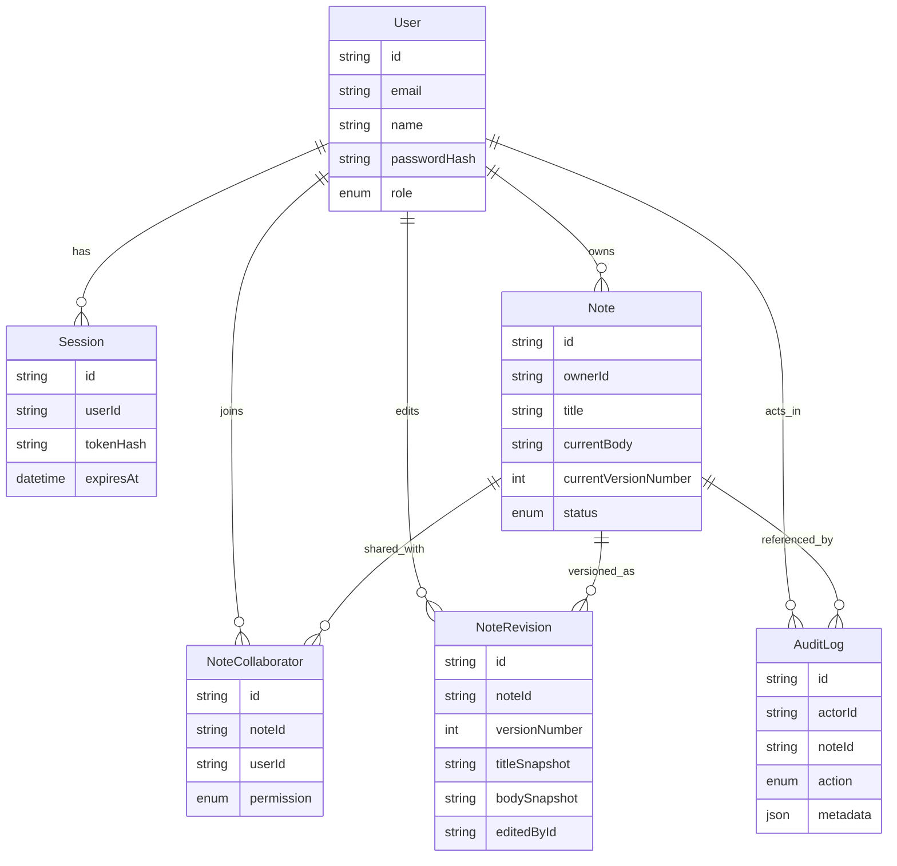

# Domain Model

## User
Model: `prisma/schema.prisma` — `model User`
Primary service: `src/services/auth-service.ts` — `login()`

## Session
Model: `prisma/schema.prisma` — `model Session`
Primary service: `src/services/auth-service.ts` — `login()` and `src/lib/auth/session.ts` — `resolveRequestSession()`

## Note
Model: `prisma/schema.prisma` — `model Note`
Primary service: `src/services/note-service.ts` — `createNote()`, `getNoteDetail()`, `updateNote()`, and `updateStatus()`

## NoteCollaborator
Model: `prisma/schema.prisma` — `model NoteCollaborator`
Primary service: `src/services/note-service.ts` — `upsertCollaborator()`

## NoteRevision
Model: `prisma/schema.prisma` — `model NoteRevision`
Primary service: `src/services/note-service.ts` — `updateNote()` and `listRevisions()`

## AuditLog
Model: `prisma/schema.prisma` — `model AuditLog`
Primary service: `src/services/auth-service.ts`, `src/services/note-service.ts`, and `src/services/audit-log-service.ts`
